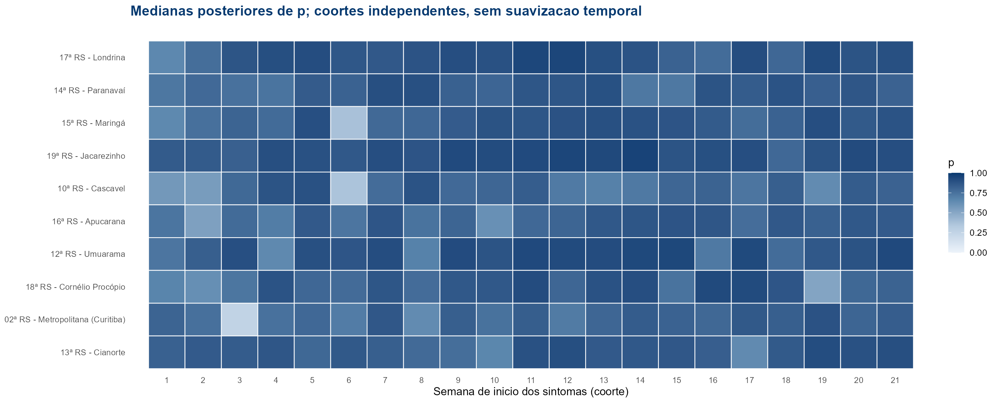
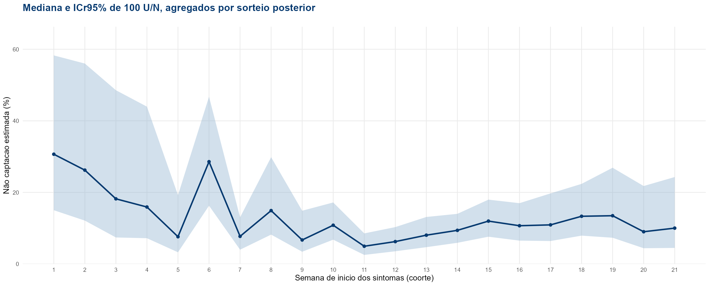

# Modelo de Captura com Remoção para Estimação da Subnotificação de Dengue no Paraná

**Modelo multinomial bayesiano com aumento de dados e amostragem de Gibbs | 70ª RBras**

Repositório com os códigos, os resultados agregados e o pôster científico de um estudo sobre a **não captação de notificações de dengue no Paraná, em 2025**. A análise considera a semana de início dos sintomas, a Regional de Saúde (RS) de residência e um horizonte de **quatro semanas para a primeira notificação**.

**Autores:** Márcio Roger Piagio, Diogo Francisco Rossoni e George Lucas Moraes Pezzott  
**Instituição:** Programa de Pós-Graduação em Bioestatística — Universidade Estadual de Maringá (UEM)

## Objetivo

Descrever a distribuição semanal e regional dos registros de dengue no Paraná em 2025 e estimar, nas dez Regionais de Saúde selecionadas, a probabilidade semanal de primeira notificação, o total latente de casos e a proporção não captada durante quatro semanas de acompanhamento.

## Dados e delineamento

- **Fonte original:** Sistema de Informação de Agravos de Notificação (SINAN/DATASUS), arquivo `DENGBR25.dbc`.
- **Análise descritiva:** 22 Regionais de Saúde e 106.899 notificações observadas em 2025, conforme os filtros do estudo.
- **Seleção para inferência:** dez RS com maior número absoluto de notificações anuais (82,7% dos registros descritos).
- **Coortes:** 21 semanas completas de início dos sintomas, de **01/01 a 27/05/2025**, ancoradas em 1º de janeiro; *não correspondem à numeração oficial de semanas epidemiológicas*.
- **Acompanhamento:** até quatro semanas após o início dos sintomas de cada pessoa.
- **Base de estimação:** 78.716 notificações observadas, em **210 combinações RS × coorte**.

A Regional de Saúde é definida pelo município de residência. O processamento original considera os critérios de elegibilidade e exclusões descritos no estudo; os registros selecionados **não devem ser interpretados indistintamente como casos laboratorialmente confirmados**.

> **Escopo da reprodutibilidade:** os arquivos CSV deste repositório resultam de uma reprodução MCMC sobre as contagens semanais agregadas extraídas do relatório. Essa reprodução **não equivale à auditoria ou releitura independente do arquivo original `DENGBR25.dbc`**. Os microdados não fazem parte deste pacote.

## Modelo estatístico

Para cada RS e coorte semanal, consideram-se quatro contagens observadas `Y1`, `Y2`, `Y3` e `Y4`, correspondentes à **semana de acompanhamento da primeira notificação**. O modelo inclui duas categorias latentes, `A` e `B`:

$$
(Y_1,Y_2,Y_3,Y_4,A,B)\mid N,p,\theta
\sim \operatorname{Multinomial}(N;\pi_1,\ldots,\pi_4,\pi_A,\pi_B),
$$

com

$$
\begin{aligned}
\pi_1&=p,\\
\pi_j&=\theta p(1-p)^{j-1},\quad j=2,3,4,\\
\pi_A&=(1-p)(1-\theta),\\
\pi_B&=\theta(1-p)^4.
\end{aligned}
$$

Aqui, `p` é a probabilidade de primeira notificação na semana inicial de acompanhamento; `θ` representa a permanência latente no mecanismo de observação; `A` representa a saída desse mecanismo sem notificação após a primeira semana; e `B` representa permanência sem notificação até o fim da quarta semana.

As quantidades de interesse são:

$$
C=\sum_{j=1}^{4}Y_j,\qquad N=C+A+B,\qquad U=A+B,\qquad
\mathrm{NC}(\%)=100\frac{U}{N}.
$$

As distribuições a priori da parametrização semanal são:

$$
p\sim\operatorname{Beta}(1,1),\quad
\theta\sim\operatorname{Beta}(1,1),\quad
\lambda\sim\operatorname{Gamma}(2,0{,}02/7),\quad
N\mid\lambda\sim\operatorname{Poisson}(\lambda),
$$

com a Gamma em parametrização **forma–taxa**. Os ajustes por RS e coorte são independentes; a união dos pontos nos gráficos de linha **não representa suavização temporal pelo modelo**.

## Resultados do pôster

Resultados da **mesma reprodução independente do Gibbs**, a partir das contagens agregadas do relatório:

| Indicador | Resultado | Intervalo de credibilidade de 95% |
|---|---:|---:|
| Notificações observadas (`C`) | **78.716** | Não se aplica |
| Total latente estimado (`N`) | **89.600** | 87.830–92.097 |
| Casos não captados (`U`) | **10.884** | 9.114–13.381 |
| Não captação estimada (`100U/N`) | **12,1%** | **10,4%–14,5%** |

Os totais se referem **somente às dez RS selecionadas e às 21 coortes modeladas**, e não a uma estimativa anual para todo o Paraná. A expressão *não captação* significa **ausência de notificação dentro das primeiras quatro semanas após o início dos sintomas**, não ausência definitiva de notificação.

A reprodução utilizou **3 cadeias, 100.000 iterações por cadeia, 20.000 de aquecimento e `thin = 50`**. O maior Rhat clássico reportado entre os ajustes foi aproximadamente **1,012**. A avaliação de sensibilidade às distribuições a priori, em especial à de `λ`, continua sendo uma etapa recomendada.

## Gráficos do estudo

**Probabilidade de primeira notificação (`p`) por RS e coorte semanal**



**Não captação agregada nas dez RS por semana, com ICr95%**



O mapa de calor apresenta medianas por combinação RS–coorte. Já a curva e seus intervalos são obtidos pela **agregação de sorteios posteriores**, não pela soma de medianas ou de limites de intervalos individuais.

## Organização dos arquivos

```text
.
├── README.md
├── poster.tex
├── rbras-poster.cls
├── poster.pdf
├── GERAR_GRAFICOS_E_CONFERIR_BANNER.R
├── CONTAGENS_Y1_Y4_210_COORTES_FONTE_RELATORIO.csv
├── COORTES_210_MESMA_EXECUCAO.csv
├── REGIONAIS_10_MESMA_EXECUCAO.csv
├── SERIE_21_SEMANAS_POSTERIOR.csv
├── TOTAL_MESMA_EXECUCAO.csv
├── 10D_heatmap_P_COORTES_SEMANAIS.pdf
├── 10D_heatmap_P_COORTES_SEMANAIS.png
├── 11A_CURVA_SEMANAL_SUB_TOP10_ICR95.pdf
├── 11A_CURVA_SEMANAL_SUB_TOP10_ICR95.png
├── 10C_heatmap_SUB_COORTES_SEMANAIS.pdf   # mapa complementar
├── logo-rbras.png
├── logo-instituicao.png
└── LaTeX/                                 # imagens auxiliares do pôster
```

Os CSVs de coortes, regionais, série semanal e total agregado pertencem à **mesma execução**, evitando diferenças decorrentes da combinação de rodadas MCMC distintas.

## Como reproduzir os gráficos no R

**Requisitos:** R e pacote [`ggplot2`](https://ggplot2.tidyverse.org/). Instalação:

```r
install.packages("ggplot2")
```

Na pasta que contém este README e os CSVs, execute:

```r
source("GERAR_GRAFICOS_E_CONFERIR_BANNER.R", encoding = "UTF-8")
```

Se estiver em outro diretório, informe o caminho completo dentro de `source(...)`. A configuração padrão do script é:

```r
recalcular_gibbs = FALSE
```

Nesse modo, **não há nova estimação**: o script confere a estrutura dos CSVs e regenera os dois gráficos do pôster em PDF e PNG, além de um mapa de calor complementar de não captação.

### Reexecutar o Gibbs (opcional)

Edite `GERAR_GRAFICOS_E_CONFERIR_BANNER.R` e altere a configuração para:

```r
recalcular_gibbs = TRUE
```

O script usa as quatro contagens observadas de cada uma das 210 combinações e grava os novos resultados na pasta `REEXECUCAO_R/`, sem sobrescrever os arquivos de referência. **Se utilizar essa nova execução, atualize também as duas tabelas, a mensagem principal e as conclusões de `poster.tex`**, mantendo gráficos e números da mesma rodada.

Esta operação **não relê o `.dbc`**: a verificação dos filtros e dos dados individuais requer o pipeline original de preparação do SINAN.

## Como compilar o pôster

**Requisitos:** distribuição LaTeX com os pacotes utilizados em `rbras-poster.cls`, incluindo TikZ, PGFPlots, `tcolorbox` e `qrcode`.

Na pasta do projeto:

```bash
pdflatex poster.tex
pdflatex poster.tex
```

O arquivo `poster.pdf` é produzido em **formato A0 vertical**, com a identidade visual da 70ª RBras. Mantenha os logotipos e os PDFs dos gráficos nos caminhos utilizados pelo `.tex`.

## Limitações e cuidados de interpretação

- A seleção das dez RS não constitui uma amostra probabilística de todo o Paraná.
- Os resultados são condicionais ao modelo multinomial, às distribuições a priori e aos critérios de seleção das notificações.
- As estimativas de `N` e `U` podem ser sensíveis à priori de `λ` e à pequena quantidade de notificações tardias em certas coortes.
- Rhat próximo de 1, isoladamente, não assegura identificabilidade, calibração ou robustez; são importantes verificações complementares de ESS, sensibilidade e adequação do modelo.
- Os intervalos dos totais são calculados a partir das amostras posteriores agregadas, **não** pela soma dos limites de cada coorte.

## Referências essenciais

1. Zippin, C. (1956). An evaluation of the removal method of estimating animal populations. *Biometrics*, 12(2), 163–189.
2. Haines, L. M. (2020). Multinomial N-mixture models for removal sampling. *Biometrics*, 76(2), 540–548.
3. Brintz, B.; Fuentes, C.; Madsen, L. (2018). An asymptotic approximation to the N-mixture model for the estimation of disease prevalence. *Biometrics*, 74(4), 1512–1518.
4. Angelo, M. et al. (2020). Dengue surveillance system in Brazil: a qualitative study in the Federal District. *International Journal of Environmental Research and Public Health*, 17(6), 2062.

**Fonte dos dados:** SINAN/DATASUS — `DENGBR25.dbc` (2025).

## Contato

Márcio Roger Piagio — Programa de Pós-Graduação em Bioestatística, UEM.  
E-mail: **pg56683@uem.br**

---

*Projeto científico desenvolvido para apresentação na 70ª Reunião Anual da Região Brasileira da Sociedade Internacional de Biometria (RBras).*
